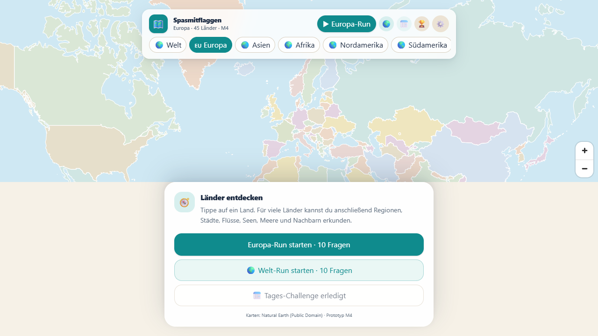

# Spasmitflaggen

Geografie-Spiel für den Browser — später Android. Länder werden nicht über Flaggen, sondern über ihre Orte, Landschaften und Rekorde entdeckt.

**Aktueller Stand: M4 (Welt).** Die Weltkarte läuft im Browser. 193 Länder auf sechs Kontinenten lassen sich antippen, dazu 4.038 Regionen (Bundesländer, Kantone, Provinzen, Präfekturen …). Der Quiz-Modus ist spielbar: Multiple Choice, Drag-to-Map, Land antippen, Region antippen sowie Fragen zu Städten, Flüssen, Seen, Meeren, Meerengen, Nachbarn und Ländervergleichen. Nach der Auflösung wird das Ziel auf der Karte markiert — Flüsse als Linie, Seen und Meere als Fläche, Berge und Städte als Punkt. Der Länder-Atlas zeigt alle Fakten, Orte, Gewässer und Regionen; Mastery, Erfolge, Tages-Challenge, Onboarding, Sound und Einstellungen sind aktiv. **1.162 Fakten** (58 kuratiert + 1.104 generiert) und **620 Karten-Reveals** decken alle Länder ab.



Weitere Eindrücke: [Länder-Steckbrief China](docs/m4-country-china.png) · [Länder-Atlas China](docs/m4-atlas-china.png) · [Welt-Run](docs/m4-world-run.png) · [Region-Frage](docs/m4-region.png) · [Region-Auflösung](docs/m4-region-reveal.png) · [Meer-Auflösung](docs/m4-sea-reveal.png) · [Sammlung](docs/m4-collection.png) · [Quiz-Run](docs/m1-run.png) · [Onboarding](docs/m3-onboarding.png) · [Einstellungen](docs/m3-settings.png)

## Schnellstart

```bash
npm install
npm run dev
```

Öffne <http://localhost:5173>.

## Befehle

| Befehl | Zweck |
|---|---|
| `npm run dev` | Vite-Dev-Server starten |
| `npm run build` | TypeScript prüfen und Produktions-Build erzeugen |
| `npm run preview` | Produktions-Build lokal testen |
| `npm run data` | Kartendaten, Fakten und Reveals aus Natural Earth neu erzeugen |
| `npm run data:reference` | Wikidata- und Weltbank-Referenzdaten neu abrufen |
| `npm run data:flags` | Länderflaggen von flagcdn laden |
| `npm run validate` | Datenbestand prüfen (Länder, Regionen, Flaggen) |
| `npm run test` | Unit-Tests (Vitest) |
| `npm run e2e` | Browser-Tests (Playwright, systemweites Chrome) |
| `npm run check` | TypeScript + Datenvalidierung + Unit-Tests |
| `npm run android:sync` | Web-Build erzeugen und nach `android/` synchronisieren |
| `npm run android:build` | Debug-APK über Gradle bauen (JDK 21 + Android SDK nötig) |

## Android

Die Web-App läuft über **Capacitor 7** in einer Android-WebView. Der native Projektordner liegt in `android/`.

Voraussetzungen:

- JDK 21 (`JAVA_HOME`)
- Android SDK mit Platform 35 und Build-Tools 35 (`ANDROID_HOME`)

```bash
npm run android:sync
npm run android:build
```

Das Debug-APK liegt danach unter `android/app/build/outputs/apk/debug/app-debug.apk`. Die Zurück-Taste schließt zuerst Dialoge, den Atlas, den Run oder die Länderauswahl, bevor sie die App verlässt. Safe Areas sind über `env(safe-area-inset-*)` berücksichtigt.

## Stack

- **React 19 + TypeScript + Vite**
- **MapLibre GL JS** für interaktive Vektorkarten
- **Tailwind CSS 4** für das UI
- **Vitest + Playwright** für Tests
- **Capacitor** ist für die spätere Android-Hülle vorgesehen

## Daten

Die Karten und Basisdaten werden aus **Natural Earth 1:10m** (Public Domain) erzeugt:

- Länderpolygone (Welt, 193 Länder inkl. Kosovo, Nordzypern und Somaliland)
- 4.038 Admin-1-Regionen für 187 Länder; DACH und FR/IT/ES/PL/NL mit handgeprüften ersten Ebenen
- Hauptstädte aus dem Natural-Earth-Layer „Populated Places“
- Höhenpunkte aus Wikidata, Einwohner und Fläche aus der Weltbank (2023)
- 1.162 Fakten: 58 kuratiert, 1.104 aus Natural Earth/Weltbank generiert
- 620 Karten-Reveals für Flüsse, Seen, Meere, Meerengen, Städte und Gipfel

Die Pipeline liegt in `tools/build-data.ts`, `tools/build-generated-facts.ts` und `tools/build-reveals.mjs`. Rohdaten liegen in `data/raw/` (nicht im Repo), die erzeugten Dateien in `public/data/`.

Flaggen: [flagcdn.com](https://flagcdn.com/) (freie Nutzung, Attribution im Credits-Screen).

## Projektstruktur

```
src/
  app/          App-Shell und Datenladen
  components/   CountrySheet, QuestionCard, Atlas, Sammlung, Einstellungen
  map/          MapLibre-View, Layer, Interaktion, Reveals
  data/         Typen, Loader, Kontinent-Metadaten
  game/         QuestionEngine, Scoring, Atlas, Erfolge, Daily
public/
  data/         countries.json, world.geojson, world-regions.geojson, Fakten, Reveals
  flags/        SVG-Flaggen
tools/          Datenaufbau, Referenzdaten und -validierung
e2e/            Playwright-Tests
docs/           Screenshots
```

## Nächste Schritte (M5)

- Android-Build über Capacitor, Safe Areas, Zurück-Taste und Performance
- Content-QA und Playtest auf Mobilgeräten
- Optionale Vertiefung: weitere Städte, Wahrzeichen und Extrem-Fakten

Der vollständige Plan steht in [`PLAN.md`](PLAN.md).
