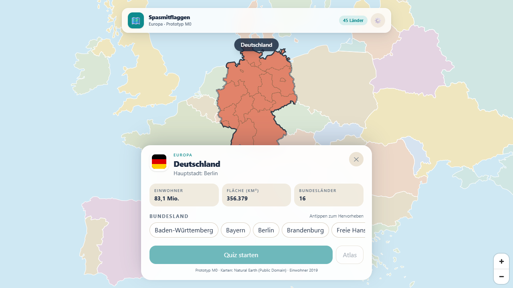

# Spasmitflaggen

Geografie-Spiel für den Browser — später Android. Länder werden nicht über Flaggen, sondern über ihre Orte, Landschaften und Rekorde entdeckt.

**Aktueller Stand: M3 (Europa & Politur).** Die Europa-Karte läuft im Browser, Länder und DACH-Regionen lassen sich antippen. Der Quiz-Modus ist spielbar: Multiple Choice, Drag-to-Map, Land antippen, Bundesland/Kanton antippen sowie Fragen zu Meeren und Meerengen. Nach der Auflösung wird das Ziel auf der Karte markiert — Flüsse als Linie, Seen und Meere als Fläche, Berge und Städte als Punkt. Der Länder-Atlas zeigt alle Fakten, Orte, Gewässer und Regionen; Mastery, Erfolge, Tages-Challenge, Onboarding, Sound und Einstellungen sind aktiv. 95 Fakten (58 kuratiert + 37 generiert) decken alle europäischen Länder mit Kernfakten ab.



Weitere Eindrücke: [Quiz-Run](docs/m1-run.png) · [Feedback](docs/m1-feedback.png) · [Meerengen-Frage](docs/m1-strait.png) · [Fluss-Auflösung](docs/m2-reveal-river.png) · [See-Auflösung](docs/m2-reveal-lake.png) · [Länder-Atlas](docs/m2-atlas.png) · [Sammlung](docs/m2-collection.png) · [Tages-Challenge](docs/m2-daily.png) · [Onboarding](docs/m3-onboarding.png) · [Einstellungen](docs/m3-settings.png)

## Schnellstart

```bash
npm install
npm run dev
```

Öffne <http://localhost:5173>.

## Befehle

| Befehl | Zweck |
|---|---|
| `npm run dev` | Vite-Dev-Server starten |
| `npm run build` | TypeScript prüfen und Produktions-Build erzeugen |
| `npm run preview` | Produktions-Build lokal testen |
| `npm run data` | Kartendaten aus Natural Earth neu erzeugen |
| `npm run validate` | Datenbestand prüfen (Länder, Regionen, Flaggen) |
| `npm run test` | Unit-Tests (Vitest) |
| `npm run e2e` | Browser-Tests (Playwright, systemweites Chrome) |
| `npm run check` | TypeScript + Datenvalidierung + Unit-Tests |

## Stack

- **React 19 + TypeScript + Vite**
- **MapLibre GL JS** für interaktive Vektorkarten
- **Tailwind CSS 4** für das UI
- **Vitest + Playwright** für Tests
- **Capacitor** ist für die spätere Android-Hülle vorgesehen

## Daten

Die Karten und Basisdaten werden aus **Natural Earth 1:10m** (Public Domain) erzeugt:

- Länderpolygone (Europa, 45 Länder inkl. Kosovo)
- Admin-1-Regionen für Deutschland, Österreich und die Schweiz
- Hauptstädte aus dem Natural-Earth-Layer „Populated Places“
- Einwohner und Fläche aus World-Bank-/Wikidata-Referenzdaten (2023)
- 95 Fakten für alle 45 Länder: 58 kuratiert, 37 aus Natural Earth generiert (Flüsse/Seen), inkl. Meere und Meerengen

Die Pipeline liegt in `tools/build-data.ts` und wird mit `npm run data` ausgeführt. Rohdaten liegen in `data/raw/` (nicht im Repo), die erzeugten Dateien in `public/data/`.

Flaggen: [flagcdn.com](https://flagcdn.com/) (freie Nutzung, Attribution im Credits-Screen vorgesehen).

## Projektstruktur

```
src/
  app/          App-Shell und Datenladen
  components/   CountrySheet, spätere QuestionCard, HUD, …
  map/          MapLibre-View, Layer, Interaktion
  data/         Typen und Loader
  game/         Geo-Mathematik, später QuestionEngine/Scoring
public/
  data/         countries.json, Europa-GeoJSON, DACH-Regionen
  flags/        SVG-Flaggen
tools/          Datenaufbau und -validierung
e2e/            Playwright-Tests
docs/           Screenshots
```

## Nächste Schritte (M4)

- Android-Build über Capacitor, Safe Areas, Zurück-Taste und Performance
- Regionen für weitere Länder (Frankreich, Italien, Spanien, Polen …)
- Playtest, Content-QA und Store-Vorbereitung

Der vollständige Plan steht in [`PLAN.md`](PLAN.md).
